<!-- You opened the source. Good instinct. -->

<p align="center">
  
</p>

<p align="center">
  
  
  
  
  
</p>

### Hi 👋

I'm a SOC analyst. In practice, I spend my days reading logs and looking for **the one line that doesn't add up**.

I'm a bit of a jack-of-all-trades and genuinely nosy: I like taking security mechanisms apart to see how they hold together, and where they give way. I look at both defense *and* offense, because you can't really learn one without the other.

This is where I keep my scripts, notes and experiments. Nothing groundbreaking, just things I wanted to understand.

### 🔁 Both sides

<p align="center">
  
</p>

### 🗂️ Triage notes

```yaml
role:       SOC analyst
method:     observe → doubt → verify
field:      logs, network, systems, and whatever lurks in between
defense:    detection, investigation, incident response
offense:    CTFs, labs, understanding how things break
currently:  figuring out why the things that work actually work
```

<p align="center">
  <sub>Understand offense to defend better. And the other way around.</sub>
</p>
