<!-- You opened the source. Good instinct. -->

<p align="center">
  
</p>

<p align="center">
  
  
  
  
  
  
</p>

### Hi 👋

I'm a SOC analyst. I spend my days reading logs and looking for **the one line that doesn't add up**.

Jack-of-all-trades, genuinely nosy, and a bit of a nerd. I like taking security mechanisms apart to see how they hold together and where they give way. I'm always learning something new, and I use **AI** a lot to go further and faster: as a sparring partner, not a crutch.

### 🛡️ What I do

- **Triage & investigation**: turning raw alerts into a clear story: what happened, how far it went, what to do next.
- **Detection engineering**: writing and tuning rules, cutting noise without losing signal, mapping coverage to MITRE ATT&CK.
- **Threat hunting**: starting from a hypothesis rather than an alert, across endpoint, network and identity data.
- **Incident response support**: scoping, timelines, containment recommendations, clean write-ups.
- **Automation & AI**: Python tooling to enrich alerts and query the SIEM, plus LLMs to speed up triage and summaries, with a human always checking the output.

### 🔬 Research: DRM & content protection

On my own time, I study how **DRM and content protection schemes** work under the hood: license acquisition flows, key handling, white-box cryptography, and the obfuscation and anti-tamper layers in client applications.

Same question as in the SOC: *where is trust placed, and what happens when that assumption breaks?*

My workflow is **AI-augmented**: reverse engineering tools wired into AI agents through **MCP servers** like [REA](https://github.com/morluto/rea) (Ghidra, IDA, Hopper backends). The agent decompiles, searches and traces; I steer the analysis and verify what it finds.

<sub>Research is done for learning purposes, on my own devices and lawfully obtained content. No piracy, no key sharing.</sub>

### 🔁 Both sides

<p align="center">
  
</p>

### 🧪 Currently exploring

- How far AI agents + MCP can go in real reverse engineering work, and where they start to hallucinate
- License flows and client-side hardening across different content protection schemes
- Detection ideas that come straight from understanding the attacker's side

### 🧰 Toolbox

| Area | Tools |
|---|---|
| **SIEM & data** | Elasticsearch, Kibana, Logstash |
| **Detection** | Sigma, YARA, KQL, MITRE ATT&CK |
| **Network** | Wireshark, tcpdump |
| **Reverse engineering** | Ghidra, IDA, Frida |
| **AI & MCP** | LLM agents, MCP servers (REA) |
| **Scripting** | Python, Bash, Linux, Git |

### 🗂️ Triage notes

```yaml
role:       SOC analyst
method:     observe → doubt → verify
field:      logs, network, systems, and whatever lurks in between
research:   DRM internals, license flows, client-side hardening
mode:       always learning, mildly nerdy, endlessly curious
currently:  figuring out why the things that work actually work
```

<p align="center">
  <sub>Understand offense to defend better. And the other way around.</sub>
</p>
